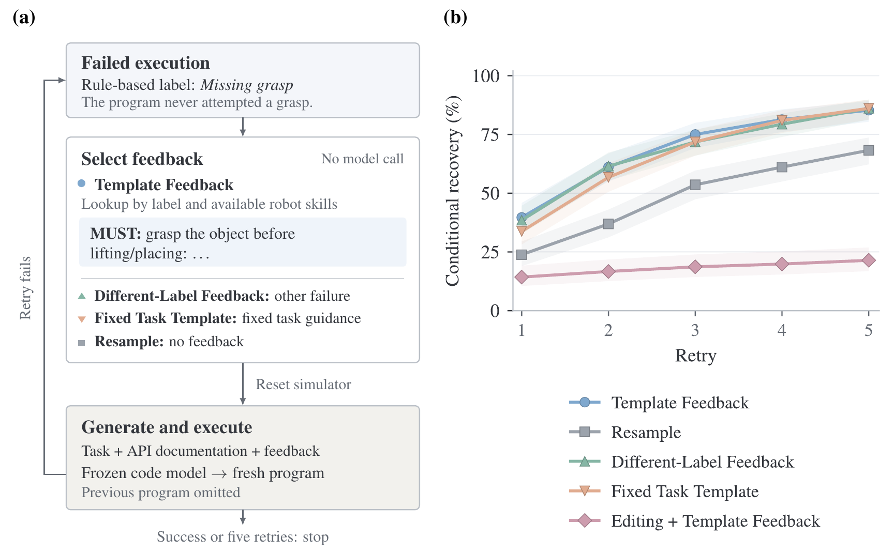

# Rethinking Self-Repair in Code-as-Policy Agents: What Drives Retry Success?

<p align="center">
  <a href="https://arxiv.org/abs/2611.06863"></a>
  &nbsp;
  <a href="https://learn-at-deploy.github.io/"></a>
</p>

RoboRepair studies how robot code agents recover from failed programs. **In our experiments, simple task guidance and feedback tailored to the failure yield similar recovery rates.**

<p align="center">
  
</p>

*How retries work and how often each approach succeeds.*

---

## Install

```bash
git clone https://github.com/siddharthaphale/roborepair.git && cd roborepair
uv venv --python 3.12
source .venv/bin/activate
uv pip install -r envs/requirements-gpu.txt -e .
```

## Running experiments

Run the neutral-prompt comparison:

```bash
MUJOCO_GL=disable python experiments/feedback_comparison.py \
  --config configs/neutral_prompt_study/neutral_prompt_comparison.yaml \
  --seed 0 \
  --output-dir runs/neutral_prompt_comparison_seed0
```

See [experiments/](experiments/) for the other studies and [configs/](configs/) for their settings.

## Citation and license

Please cite our [paper](https://arxiv.org/abs/2611.06863) when using this work. Code is released under the [MIT license](LICENSE).
